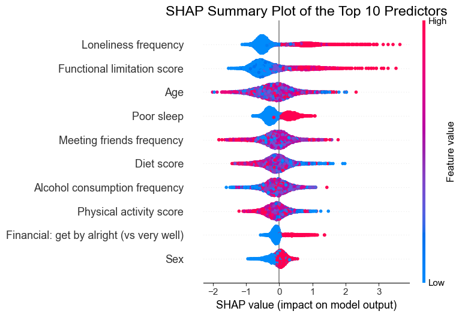
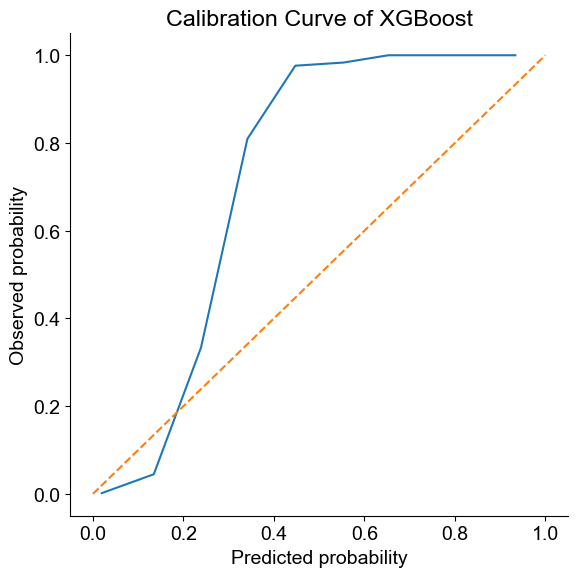
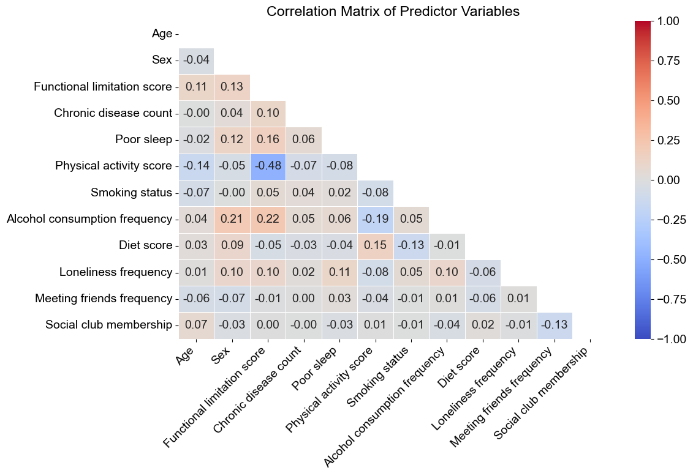
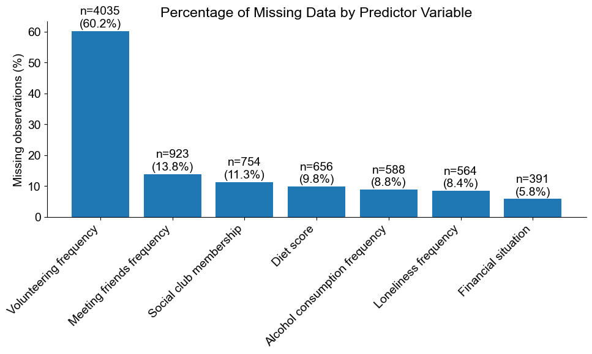

# Predicting Incident Depression in Older Adults Using Interpretable Machine Learning

An interpretable machine learning project investigating the prediction of incident depression in older adults using longitudinal data from the English Longitudinal Study of Ageing (ELSA).

Completed as part of my MSc Data Science dissertation at the University of Sheffield.

## Project Overview

Depression in later life presents significant health and social challenges. This project investigated whether sociodemographic, health, behavioural and social factors could predict incident depression among older adults.

Three machine learning models were developed and compared:

- Logistic Regression
- Random Forest
- XGBoost

The analysis evaluated predictive performance, model calibration, feature importance, predictor domains, demographic subgroups and temporal changes in selected predictors.

The objective was to identify important predictors of incident depression and assess whether more complex machine learning approaches offered advantages over traditional statistical models.

## Methodology

The analytical workflow included:

- **Data preprocessing:** Data cleaning, feature engineering, missing-data assessment and iterative imputation.
- **Feature preparation:** One-hot encoding of categorical variables and multicollinearity assessment.
- **Model development:** Logistic Regression, Random Forest and XGBoost.
- **Model optimisation:** Hyperparameter tuning and stratified five-fold cross-validation.
- **Performance evaluation:** AUROC, classification performance and probability calibration.
- **Model interpretability:** SHAP analysis and permutation feature importance.
- **Additional analyses:** Predictor-domain comparisons, age and sex subgroup analysis, temporal analysis and sensitivity analysis.

## Model Performance

| Model | AUROC |
|---|---:|
| **Logistic Regression** | **0.759** |
| Random Forest | 0.726 |
| XGBoost | 0.668 |

Logistic Regression achieved the highest AUROC, outperforming both Random Forest and XGBoost.

The models demonstrated high specificity but low sensitivity, highlighting the challenges of identifying incident depression in an imbalanced cohort.

These findings suggest that more complex machine learning approaches do not necessarily provide superior predictive performance for this task.

## Key Findings

- **Loneliness and functional limitations** were among the most influential predictors of incident depression.
- **Sleep quality and physical activity** also contributed to predictive performance.
- **Health and social predictor domains** demonstrated stronger standalone discrimination than behavioural and sociodemographic domains.
- **Temporal changes in selected predictors** did not improve prediction compared with baseline measurements.
- **Predictive performance varied modestly** across age and sex subgroups.
- **Logistic Regression outperformed more complex models**, demonstrating the value of simpler, interpretable approaches.

## Visualisations

### Predictor Importance

SHAP analysis identified the features with the greatest influence on XGBoost predictions.



### Model Calibration

Calibration analysis assessed the agreement between predicted probabilities and observed outcomes for XGBoost.



### Predictor Correlations

A correlation matrix was used to examine relationships between predictor variables before modelling.



### Missing Data Analysis

Missingness patterns were assessed before applying iterative imputation.



## Technologies and Libraries

- **Programming:** Python
- **Data manipulation:** pandas, NumPy
- **Machine learning:** scikit-learn, XGBoost
- **Model interpretability:** SHAP
- **Statistical analysis:** statsmodels, SciPy
- **Data visualisation:** Matplotlib, Seaborn
- **Development environment:** Jupyter Notebook

## Data Source

This project uses longitudinal data from the **English Longitudinal Study of Ageing (ELSA)**, obtained through the UK Data Service.

The analysis used the following datasets:

- **ELSA Wave 7**
- **ELSA Wave 8**
- **ELSA Waves 7 and 8, Institute for Fiscal Studies (IFS) derived variables**

These datasets provided the longitudinal information used to investigate predictors of incident depression among older adults.

**Official data source:** [UK Data Service, ELSA Study 5050](https://datacatalogue.ukdataservice.ac.uk/studies/study/5050#details)

The underlying participant-level datasets are not included in this public repository due to data access and licensing restrictions.

Researchers wishing to reproduce the analysis must obtain the relevant datasets independently through the UK Data Service, subject to the applicable access conditions.

Further information about the datasets and access requirements is provided in [`01_data/README.md`](01_data/README.md).

## Repository Structure

```text
incident-depression-prediction-elsa/
│
├── README.md
├── requirements.txt
├── .gitignore
│
├── 01_data/
│   └── README.md
│
├── 02_notebooks/
│   └── depression_prediction.ipynb
│
├── 03_figures/
│   ├── shap_summary.png
│   ├── calibration_curve.png
│   ├── correlation_matrix.png
│   └── missing_data.png
│
└── 04_dissertation/
    └── incident_depression_prediction_elsa_dissertation.pdf
```

## Repository Contents

- **[`01_data/README.md`](01_data/README.md)** documents the ELSA datasets used, their official source and the requirements for obtaining access.
- **[`02_notebooks/depression_prediction.ipynb`](02_notebooks/depression_prediction.ipynb)** contains the Python workflow, including data preprocessing, exploratory analysis, feature engineering, model training, evaluation and interpretability.
- **[`03_figures/`](03_figures/)** contains visualisations generated during the analysis.
- **[`04_dissertation/incident_depression_prediction_elsa_dissertation.pdf`](04_dissertation/incident_depression_prediction_elsa_dissertation.pdf)** contains the full MSc dissertation, covering the research background, methodology, results, discussion and conclusions.
- **`requirements.txt`** lists the Python libraries required to run the project.
- **`.gitignore`** specifies files and directories excluded from version control.

## Limitations

- Model sensitivity was low, limiting the identification of individuals who subsequently developed depression.
- Predictive performance does not establish causal relationships between individual predictors and depression.
- Missing data, class imbalance and the characteristics of the study population could affect model performance and generalisability.
- Findings require further external validation before consideration for clinical applications.

## Author

**Uche Dumzo-Ajufo**

MSc Data Science  
University of Sheffield